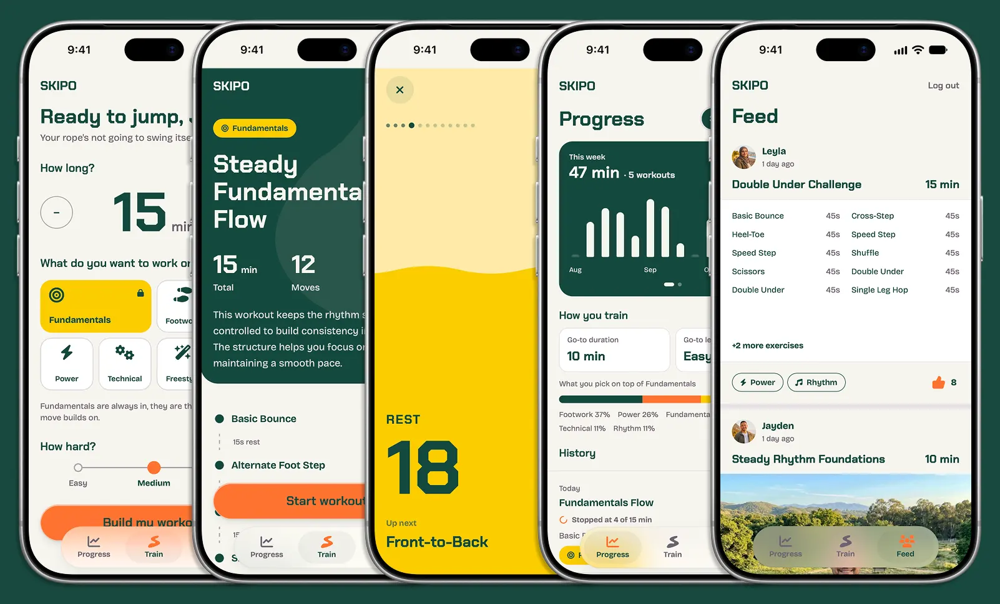
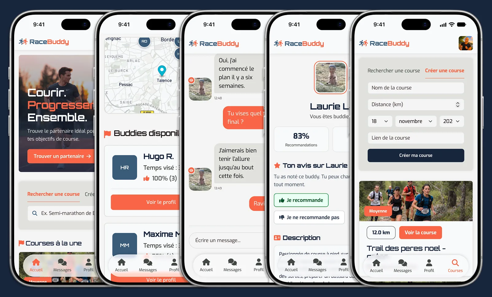
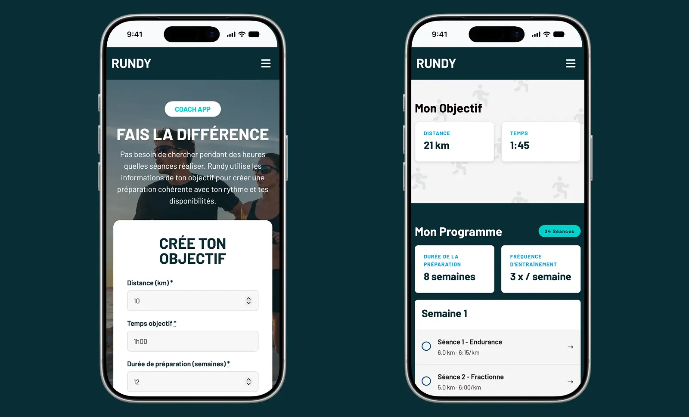

# 👋 Hi, I'm Alex

**Full-Stack Developer | Ruby on Rails · PostgreSQL · JavaScript | AI Integration | 10 Years in Operations & Process Improvement**

*From parcels and cocktails to code: I like understanding how things work, finding what's broken, and building something better.*

## About me

Ten years in logistics, hospitality and operations taught me to understand a system before trying to fix it. That's what pulled me into software. I completed Le Wagon's Software Engineering & AI bootcamp, and I'm now looking for a **junior full-stack role** (backend-leaning) where I can keep growing.

What I enjoy most: turning an idea into something real, then making it work better, from the logic behind a feature to the details of how it feels to use.

## 🛠️ Toolbox

**Backend:** Ruby · Ruby on Rails · PostgreSQL · SQL · Devise · Solid Queue · Active Storage  
**Frontend:** JavaScript · Stimulus · Turbo · HTML · CSS / Sass · Bootstrap  
**Quality & delivery:** Minitest · GitHub Actions · RuboCop · Brakeman · Git · Heroku  
**AI:** RubyLLM · structured LLM output with JSON schemas

## 🚀 Projects

### SKIPO
**AI-generated jump rope workouts · solo project, in active development**

[Live Demo](https://skipo-app-3be98c580ead.herokuapp.com) · [GitHub](https://github.com/akcodepro/skipo) · Demo: `jumper@example.com` / `letsjump`

Built solo from idea to production: product design, backend and frontend. Pick a duration, a focus and a difficulty, and SKIPO generates a workout, coaches you through it, tracks your progress and shows what others are jumping in a social feed. Ruby frames and validates what the LLM returns, so workouts come back the right length.

### RaceBuddy
**Connects runners training for the same race · team of four**

[Live Demo](https://www.racebuddy.me) · [GitHub](https://github.com/akcodepro/RaceBuddy)

I built the location matching with Mapbox, using rounded coordinates so users' exact addresses stay private, plus buddy recommendations, the homepage and the team's Git/PR workflow.

### Rundy
**AI-generated running plans · team of four**

<!--[Live Demo](https://rundy-lauriel-web-ca5e1380d7c9.herokuapp.com) · -->
[GitHub](https://github.com/akcodepro/rundy)

I built the core data models for the AI flow, the RubyLLM integration and prompt for regenerating a session from user feedback, and most of the frontend styling.

## 📚 Currently learning

Testing and edge cases · practical AI integration · React next

## 🎓 Education

**Le Wagon**, Certificate, Software Engineering & AI, 2026  
**IUT de Blois**, Professional Bachelor's, Industrial Production Management, 2013-2014

## 🤝 Let's connect

🇫🇷 French, native · 🇬🇧 English, fluent · Based in France

[**LinkedIn**](https://www.linkedin.com/in/alex-kerespars) · [**Email**](mailto:akcodepro@gmail.com)
